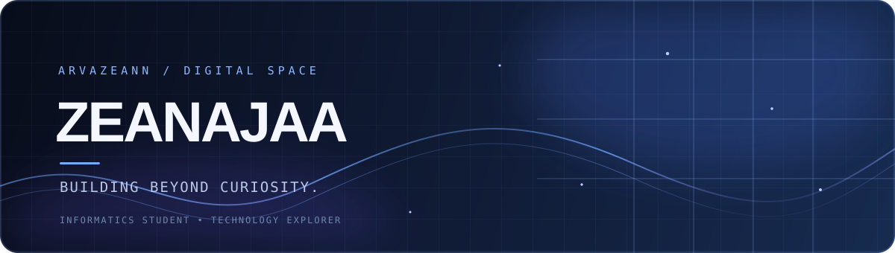

<div align="center">



<br>

<a href="https://github.com/arvazeann">
  
</a>

<br>

<a href="https://github.com/arvazeann?tab=repositories">
  
</a>
<a href="https://ruanglagi.vercel.app/">
  
</a>
<a href="https://portofolio-bad-code1.vercel.app/">
  
</a>

</div>

---

## `01` — A little about me

```text
┌──────────────────────────────────────────────────────────────┐
│  NAME       Zeanajaa                                          │
│  ROLE       Informatics Student                               │
│  MINDSET    Curious mind. Continuous learner.                 │
│  INTERESTS  Software · AI · IoT · Computer Vision             │
│  CURRENTLY  Exploring, building, and learning through code.   │
└──────────────────────────────────────────────────────────────┘
```

I enjoy understanding how technology works and turning ideas into practical projects. I'm currently exploring different areas of software development while strengthening my programming fundamentals.

I don't claim to know everything — I'm here to learn, experiment, make mistakes, and build better things over time.

## `02` — What I'm exploring

<div align="center">

| SOFTWARE DEVELOPMENT | INTELLIGENT SYSTEMS | CONNECTED DEVICES |
|:---:|:---:|:---:|
| Web applications & programming fundamentals | AI & Computer Vision | IoT & embedded projects |
| Building useful digital products | Learning how models solve problems | Connecting sensors, data, and software |

</div>

## `03` — Tech stack

**Used in my projects**

<p align="center">
  <a href="https://skillicons.dev">
    
  </a>
</p>

**Currently learning and exploring**

<p align="center">
  <a href="https://skillicons.dev">
    
  </a>
</p>

## `04` — Selected work

<table>
  <tr>
    <td width="50%" valign="top">
      <a href="https://github.com/arvazeann/Hackaton">
        
      </a>
      <br>
      <strong>RuangLagi — Preloved Marketplace</strong>
      <p>A marketplace MVP for boarding-house and student needs. Built around product discovery, buyer/seller flows, and marketplace management.</p>
      <a href="https://ruanglagi.vercel.app/">Live demo ↗</a>
    </td>
    <td width="50%" valign="top">
      <a href="https://github.com/arvazeann/Portofolio">
        
      </a>
      <br>
      <strong>Personal Portfolio</strong>
      <p>A personal website for presenting my profile, documenting my learning journey, and showcasing projects.</p>
      <a href="https://portofolio-bad-code1.vercel.app/">Live demo ↗</a>
    </td>
  </tr>
</table>

## `05` — GitHub activity

<div align="center">


<br><br>


<br><br>


</div>

## `06` — Contribution trail

<div align="center">


</div>

## `07` — Find me

<div align="center">

<a href="https://github.com/arvazeann">
  
</a>
<a href="https://portofolio-bad-code1.vercel.app/">
  
</a>

<br><br>

<sub>「 Stay curious. Keep building. 」</sub>


</div>
