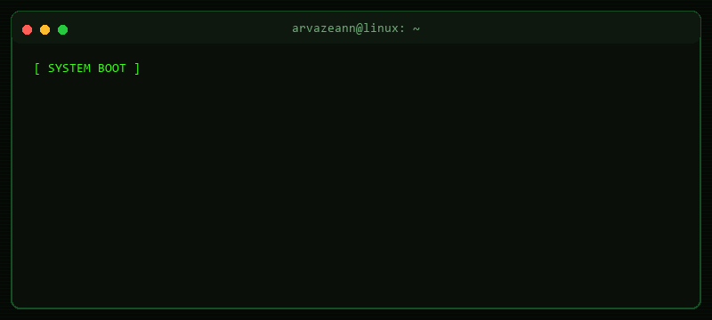
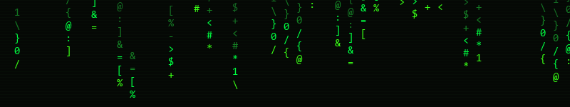

<div align="center">



<sub><a href="assets/hero-terminal.svg">Static hero fallback</a></sub>

<br>



<sub><a href="assets/matrix-rain.svg">Static rain fallback</a></sub>

<br>

[](https://github.com/arvazeann)

**`zeanajaa`** · Informatics student · technology learner

[ GitHub ](https://github.com/arvazeann) · [ Projects ](https://github.com/arvazeann?tab=repositories)

</div>


## `01` — user profile

```console
root@arvazeann:~$ whoami
> Informatics student
> Software development enthusiast
> Technology explorer

root@arvazeann:~$ cat interests.txt
> Software engineering
> Artificial intelligence · Internet of Things · computer vision
> Web development

root@arvazeann:~$ cat philosophy.txt
> Learn continuously.
> Build practically.
> Improve consistently.
```

I'm learning by exploring new technologies and building practical projects. I’m especially interested in software development, IoT, AI, and computer vision; these are learning interests, not claims of expertise.


## `02` — system modules

```text
[ LANGUAGES / USED IN PUBLIC PROJECTS ]
  C · JavaScript · TypeScript · PHP

[ FRONTEND / USED IN PUBLIC PROJECTS ]
  React · Next.js · Tailwind CSS

[ BACKEND & DATA / USED IN RUANGLAGI ]
  PostgreSQL · Prisma · Supabase Storage · Auth.js · Zod

[ DEV TOOLS / USED HERE ]
  Git · GitHub Actions

[ CURRENTLY EXPLORING ]
  Python · Arduino · OpenCV · IoT · artificial intelligence · computer vision
```

The project stack reflects visible public code and documentation. Python, Arduino, and OpenCV are technologies I'm exploring; they are not presented as experience from shipped projects. These lists describe learning and project exposure, not proficiency.


## `03` — project directory

```console
root@arvazeann:~/projects$ ls -la
drwxr-xr-x  Hackaton/       # RuangLagi marketplace MVP
drwxr-xr-x  Portofolio/    # personal learning & project portfolio
```

<table>
  <tr>
    <td width="50%" valign="top">
      <strong><a href="https://github.com/arvazeann/Hackaton">./Hackaton — RuangLagi ↗</a></strong>
      <p>A marketplace MVP for pre-loved goods aimed at students living away from home. Its documented features include public catalogs and stores, buyer and seller flows, favorites, orders, and an admin area.</p>
      <code>Next.js · TypeScript · PostgreSQL · Prisma · Auth.js · Zod · Supabase Storage</code>
    </td>
    <td width="50%" valign="top">
      <strong><a href="https://github.com/arvazeann/Portofolio">./Portofolio ↗</a></strong>
      <p>A personal website for presenting my profile, documenting my learning journey, and showcasing projects.</p>
      <code>Next.js · React · TypeScript</code>
    </td>
  </tr>
</table>


## `04` — system monitor

```text
┌─ PUBLIC REPOSITORY SIGNAL ──────────────────────────────┐
│ Languages observed: C · JavaScript · TypeScript · PHP   │
│ Contribution view: generated from GitHub's public graph │
│ Streak display: third-party live card                   │
└─────────────────────────────────────────────────────────┘
```

<div align="center">

<a href="https://github.com/arvazeann">
  
</a>

</div>

The streak image is a live third-party embed and may be unavailable occasionally. I removed the GitHub Readme Stats cards and activity graph after their public endpoints returned errors. The contribution snake below is generated by this repository's own GitHub Actions workflow.


## `05` — contribution process

<div align="center">

<picture>
  <source media="(prefers-color-scheme: dark)" srcset="https://raw.githubusercontent.com/arvazeann/arvazeann/output/github-snake-dark.svg" />
  <source media="(prefers-color-scheme: light)" srcset="https://raw.githubusercontent.com/arvazeann/arvazeann/output/github-snake.svg" />
  
</picture>

</div>


## `06` — session terminated

```console
root@arvazeann:~$ echo "Thanks for visiting"
[ CONNECTION ESTABLISHED ]
STAY CURIOUS. KEEP BUILDING.
SESSION STATUS: ONLINE
```

<div align="center">

<a href="https://github.com/arvazeann">[ github.com/arvazeann ]</a>


</div>
