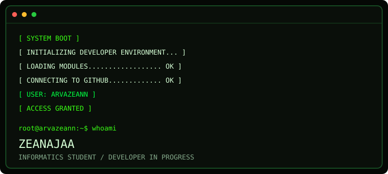
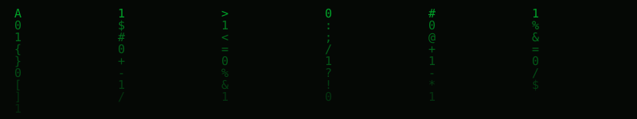
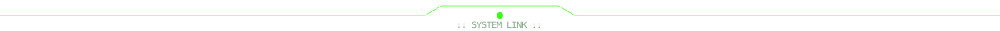
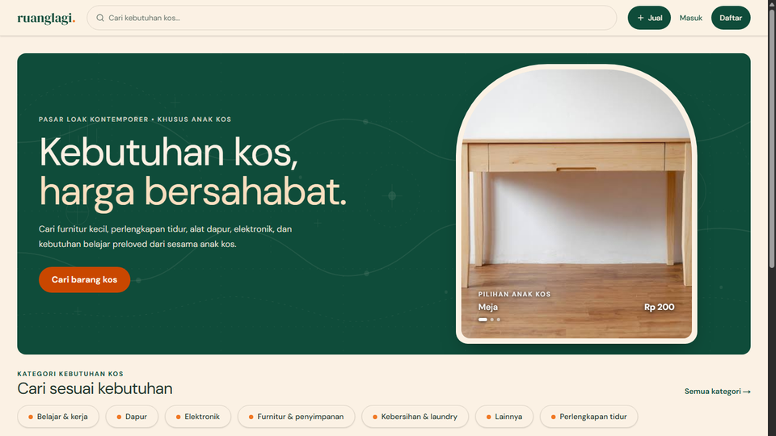
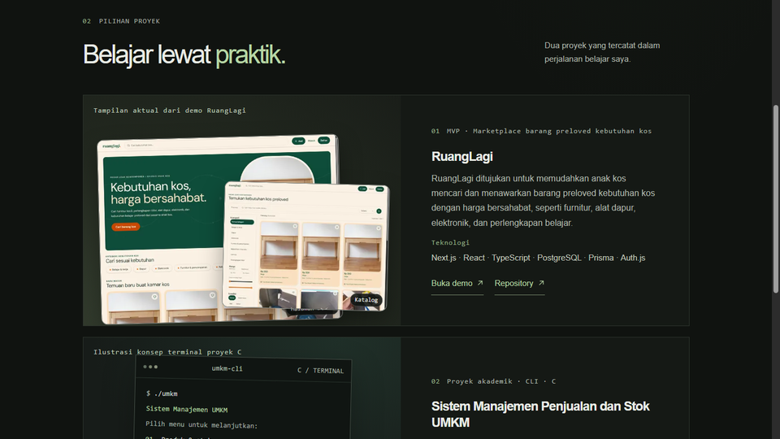
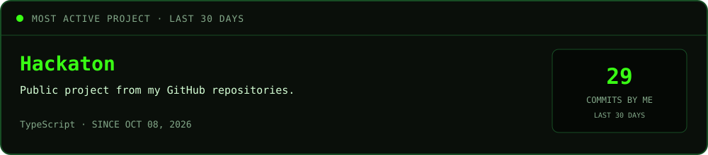
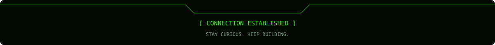

<picture>
  <source srcset="assets/hero-terminal.gif" type="image/gif" />
  
</picture>

<h1>Zeanajaa</h1>

<strong>Informatics student · aspiring software developer</strong>

Turning curiosity into code.

<a href="#selected-work">Selected work ↓</a>

<picture>
  <source srcset="assets/matrix-rain.gif" type="image/gif" />
  
</picture>

## About

I’m Zean, an Informatics student who enjoys learning how technology works and building practical projects. I’m growing my software development skills and exploring **AI, IoT, and computer vision**.

## Selected work

<table>
  <tr>
    <td width="48%" valign="middle">
      
    </td>
    <td width="52%" valign="top">
      
01 &nbsp;·&nbsp; MARKETPLACE MVP

      <h3>RuangLagi</h3>
      
A pre-loved goods marketplace MVP for students living away from home, with public catalogs, buyer and seller flows, favorites, orders, and an admin area.

      
Next.js · TypeScript · PostgreSQL · Prisma · Auth.js · Zod · Supabase Storage

      
<a href="https://ruanglagi.vercel.app/">Live project ↗</a> &nbsp;·&nbsp; <a href="https://github.com/arvazeann/Hackaton">Source code ↗</a>

    </td>
  </tr>
  <tr>
    <td width="48%" valign="middle">
      
    </td>
    <td width="52%" valign="top">
      
02 &nbsp;·&nbsp; PERSONAL WEBSITE

      <h3>Personal portfolio</h3>
      
A personal website for sharing my learning journey and selected projects, designed around a clean dark interface.

      
Next.js · React · TypeScript · Tailwind CSS

      
<a href="https://portofolio-bad-code1.vercel.app/">Live project ↗</a> &nbsp;·&nbsp; <a href="https://github.com/arvazeann/Portofolio">Source code ↗</a>

    </td>
  </tr>
</table>

## Most active project · last 30 days

The project with the most commits authored by me in the past 30 days. This card refreshes daily.

<!-- active-project:start -->

<!-- active-project:end -->

## Tools & interests

**Used in projects** 
`C` · `JavaScript` · `TypeScript` · `PHP` · `React` · `Next.js` · `Tailwind CSS` · `PostgreSQL` · `Prisma`

**Currently exploring** 
`Python` · `Arduino` · `OpenCV` · IoT · artificial intelligence · computer vision

Project use reflects learning and experimentation, not a claim of professional mastery.

## Contributions

<picture>
  <source media="(prefers-color-scheme: dark)" srcset="https://raw.githubusercontent.com/arvazeann/arvazeann/output/github-snake-dark.svg" />
  <source media="(prefers-color-scheme: light)" srcset="https://raw.githubusercontent.com/arvazeann/arvazeann/output/github-snake.svg" />
  
</picture>

Curious today. Building something better tomorrow.

